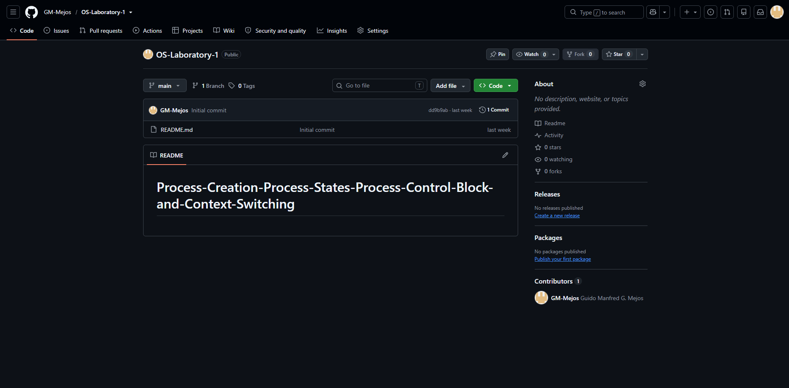
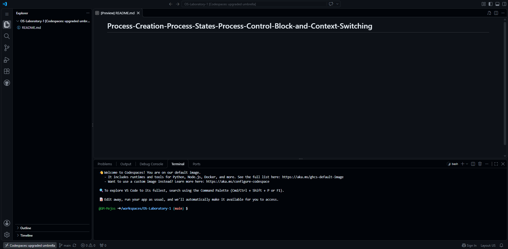
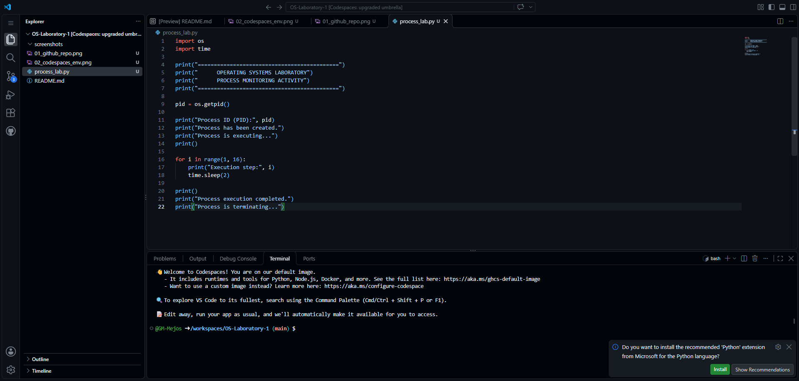
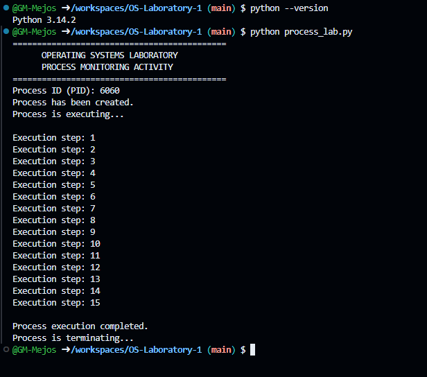
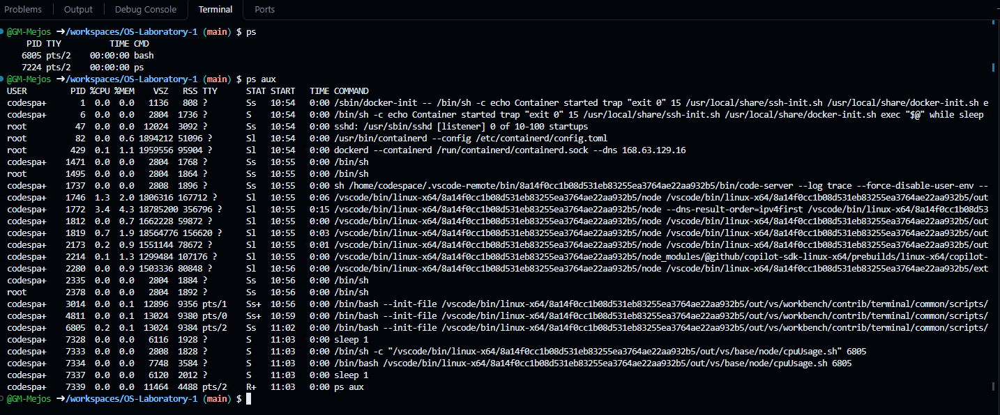
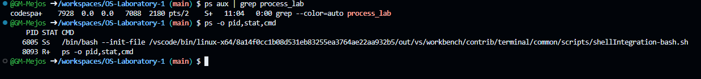
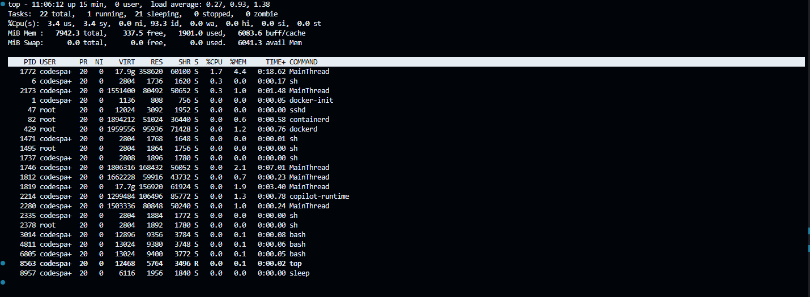
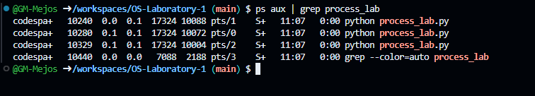

# OS Laboratory Activity No. 1
## Process Creation, Process States, Process Control Block, and Context Switching

### Student Information
- **Name:** Guido Manfred G. Mejos
- **Course and Section:** BSCA - 3 (BCA151 Operating Systems Lab)
- **Instructor:** Maria Fe Bahinting
- **Date Submitted:** November 22, 2026

---

### I. Introduction
This laboratory activity explores process creation, process states, the Process Control Block (PCB), CPU scheduling, and context switching using Python in a Linux environment via GitHub Codespaces. By executing single and concurrent Python processes and inspecting them with Linux process-management utilities (`ps`, `grep`, and `top`), this activity demonstrates how the operating system tracks, schedules, and isolates active programs.

---

### II. Lab Observations & Recorded Data

#### Part E & F — Execution & Process ID
- **Python Version:** `Python 3.14.2`
- **Recorded PID:** `6060`

**Question: Why does the operating system assign a PID to every process?**
The operating system assigns a unique Process ID (PID) to every process so the kernel can uniquely identify, track, schedule, and manage each execution instance independently—even when multiple instances of the exact same program are running simultaneously. The PID also enables resource allocation, inter-process communication (IPC), and targeted process control (such as pausing, inspecting, or terminating a specific process).

---

#### Part G — Monitoring with `ps aux`

| Information | Observation |
| :--- | :--- |
| **PID** | `6060` (Single Execution) / `10240` (Active Instance) |
| **CPU %** | `0.0%` |
| **Memory %** | `0.1%` |
| **User** | `codespace` (`codespa+`) |
| **Command** | `python process_lab.py` |

---

#### Part H — Searching with `grep`
**Discussion: How does the `grep` command help us locate a specific process?**
`ps aux` outputs a complete list of every active system and user process, which can be long and hard to scan manually. Piping its output into `grep process_lab` filters the text stream line-by-line and displays only the entries matching the pattern `process_lab`, immediately isolating our target Python process (alongside the `grep` command itself).

---

#### Part I — Observing Process States (`ps -o pid,stat,cmd`)
- **Observed `STAT` Code:** `S+` (**Interruptible Sleep**, foreground process group)
- **Explanation:** Because `process_lab.py` calls `time.sleep(2)` during each loop iteration, the process spends nearly all of its execution time waiting for the 2-second timer event to complete. While waiting, the Linux scheduler places it in the **Interruptible Sleep (`S`)** state so other runnable processes can use the CPU, briefly transitioning to **Running/Runnable (`R`)** every 2 seconds when printing the next step.

---

#### Part K — Relating Observations to the Process Control Block (PCB)
**Discussion Question: Which information observed using `ps` and `top` could be associated with information maintained by the operating system for a process?**
Several fields exposed by `ps` and `top` map directly to entries stored inside the kernel's Process Control Block (PCB):
- **Process Identification:** `PID` (Process ID) and `USER` (process owner/UID).
- **Process State:** `STAT` / `S` (`R`, `S`, `D`, `T`, `Z`), reflecting the process's current lifecycle state.
- **CPU Scheduling & Accounting Info:** `%CPU`, `TIME+`, `NI` (nice value), and `PR` (scheduling priority).
- **Memory Management Info:** `%MEM`, `VSZ` / `VIRT` (virtual memory size), and `RSS` / `RES` (resident set size / physical RAM used).
- **I/O & Execution Info:** `TTY` (controlling terminal) and `COMMAND` (executable path and arguments).

---

#### Part L — Multiple Concurrent Processes (`ps aux | grep process_lab`)

| Process | PID | State (`STAT`) | CPU % |
| :--- | :---: | :---: | :---: |
| **Process 1** | `10240` | `S+` | `0.0` |
| **Process 2** | `10280` | `S+` | `0.1` |
| **Process 3** | `10329` | `S+` | `0.1` |

**Analysis Questions:**
1. **Are the PIDs the same?**
   No, each of the three running instances has a completely distinct PID (`10240`, `10280`, and `10329`).
2. **Why are the PIDs different?**
   Every time `python process_lab.py` is launched, the OS creates a separate process with its own isolated memory space, stack, and PCB, requiring a unique PID to distinguish each instance.
3. **Are the three processes running the same program?**
   Yes, all three processes are executing the exact same program file (`process_lab.py`), demonstrating the difference between a passive program on disk and active processes in memory.
4. **Can one program create multiple processes?**
   Yes. A single program file can be executed multiple times concurrently across separate terminals, and a running process can also programmatically spawn multiple child processes (e.g., via `fork()` or Python's `multiprocessing` / `subprocess` modules).
5. **Who manages these processes?**
   The **Operating System kernel** (specifically the OS process manager and CPU scheduler) manages all active processes, allocating CPU time slices, maintaining their PCBs, and performing context switches between them.

---

### III. Required Screenshots
1. **GitHub Repository:**
   
2. **GitHub Codespaces Environment:**
   
3. **Python Source Code:**
   
4. **Program Execution Showing PID:**
   
5. **`ps aux` Output:**
   
6. **`ps -o pid,stat,cmd` Output:**
   
7. **`top` Output:**
   
8. **Multiple Instances of `process_lab.py`:**
   
